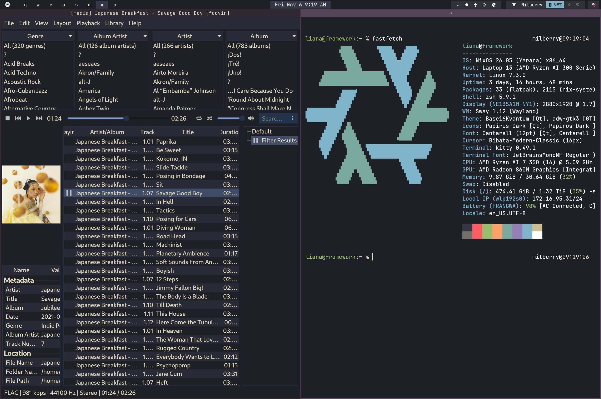

# nixops

Nixops, including my personal NixOS configuration. It's not SpectrumOS or QubesOS, but it's something.

See also [network diagram](docs/diagrams/network.svg) and my kubernetes [home-infra](https://github.com/Liana64/home-infra)

## Features

- Framework
  - Lightweight sway graphical environment with custom waybar
  - Landlock isolation using decentstate's [nix-housing](https://codeberg.org/decentstates/nix-housing) (fork, but upstream will work fine)
  - Systemd hardening, kernel tuning, hardened mounts, auditd rules, wall alerts, faillock, and usbguard
  - Compartmentalized post-quantum secrets management
  - Hardware optimizations for the AMD AI 300 series framework laptop
  - Minimal packaging, rust tools, virtualization support
  - Helix editor configuration
  - Demarcated flake management
  - Nix Impermanence
  - Bazzite-inspired just tooling, motds, misc scripts, and nixos-anywhere installer
- Media host
  - [seaweedfs](https://github.com/seaweedfs/seaweedfs) for S3
  - [Attic](https://github.com/zhaofengli/attic) nix binary cache
  - [nfs-ganesha](https://github.com/nfs-ganesha/nfs-ganesha) for userspace NFS
- Cluster
  - Talos VMs using libvirt on [NixVirt](https://github.com/AshleyYakeley/NixVirt)
  - Edge router config with CARP and WAN failover using one public IP
  - Node for RHEL lab VMs
- Catbox
  - SteamOS and TV host with Sunshine
- Portable
  - Backup host

## Framework demo

## TODO

- Move from nfs-ganesha to something more memory-safe
- OOB (Out of Band)
  - UPS NUT monitoring
  - Unifi Controller
- nix-daemon hardening
- Alternate nixpkgs
